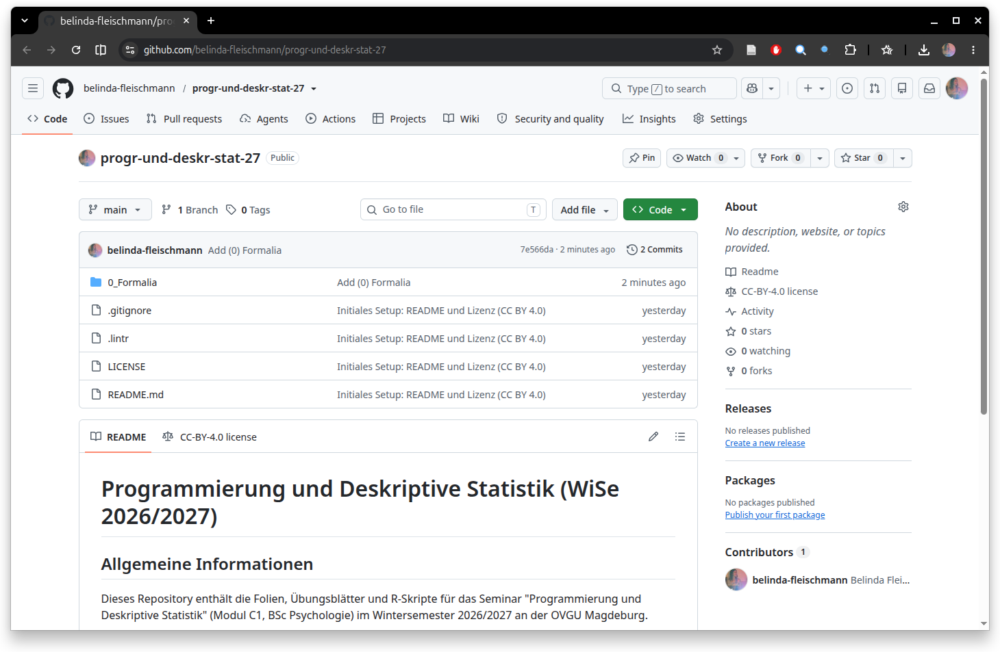

# Titelfolie {.plain}
\center
{width="20%"}

\vspace{2mm}

\Large
Programmierung und Deskriptive Statistik
\vspace{4mm}

\normalsize
BSc Psychologie WiSe 2026/27

\vspace{15mm}
\normalsize
Belinda Fleischmann

# Herzlich Willkommen!{.plain} 
\huge
\center
\vfill
Herzlich willkommen!
\vfill

# Aufnahme läuft {.plain}
\huge
\vfill

\vspace{3mm}
\center
Aufnahme läuft.
{width="8%"}

\vfill

# (0) Formalia - Titelfolie {.plain}
\vfill
\center
\huge
\textcolor{black}{(0) Formalia}
\vfill

# Lehrstuhlwebsite
\vspace{5mm}

[\textcolor{linkblue}{Homepage der Abteilung für Methodenlehre}](https://www.ipsy.ovgu.de/methodenlehre_I-path-980,1404.html)

{width="80%"}

# Formalia
\setstretch{2}

**Modul C. Einführung in empirisch-wissenschaftliches Arbeiten** (8 CP)

C1. Programmierung und Deskriptive Statistik (Seminar/Übung, 2 SWS, WiSe)

\small

* Einführung in die datenanalytische Programmierung.
* Grundlagen der deskriptiven Statistik.

\vspace{3mm}

\normalsize

C2. Analyse und Dokumentation (Seminar/Übung, 2 SWS, SoSe)

\small

* Struktur und Präsentation wissenschaftlicher Arbeiten und forschungsethische Grundsätze.
* Praktische Anwendung statistischer Analyseverfahren auf psychologische Beispieldatensätze.

# Formalia

\setstretch{1.5}

\textbf{Inhalte in C1. Programmierung und Deskriptive Statistik}

Programmierung

\small

\begin{itemize}  \justifying
\item Einführung in die Programmiersprache R und die Entwicklungsumgebung Visual Studio Code.
\item Grundlagen imperativer Programmierung in R einschließlich arithmetischer und logischer Operationen, Variablen, Datenstrukturen und Kontrollstrukturen.
\item Einführung in wesentliche Werkzeuge und Pakete für die Durchführung deskriptiver statistischer Analysen mit R.
\end{itemize}
\normalsize

\vspace{3mm}

\normalsize
Deskriptive Statistik

\small

\begin{itemize}  \justifying 
\item Tabellarische und grafische Darstellung von Daten mithilfe von Häufigkeitsverteilungen.
\item Verteilungskennwerte als Maße der zentralen Tendenz und der Datenvariabilität.
\item Praktische Anwendung auf Beispieldatensätze in R.
\end{itemize}

# Formalia
\setstretch{1.5}
Organisation

\small

\begin{itemize}
\item Mittwochs 15-17 Uhr (Gruppe 1) und 13-15 Uhr (Gruppe 2) im Raum G22A-011
\item Tutorien: Organisation über die \textcolor{linkblue}{\href{https://elearning.ovgu.de/course/view.php?id=22151}{Moodleseite des Tutoriums}}
\item Kursmaterialien (Folien, Übungsblätter, Code) auf der \textcolor{linkblue}{\href{https://www.ipsy.ovgu.de/Institut/Abteilungen+des+Institutes/Methodenlehre/Lehre/Wintersemester+2027/Programmierung+und+Deskriptive+Statistik.html}{Kurswebseite}} und auf \textcolor{linkblue}{\href{https://github.com/belinda-fleischmann/progr-und-deskr-stat-27}{GitHub}}
\item Empfohlene Vorbereitung: \textcolor{linkblue}{\href{https://www.ipsy.ovgu.de/Institut/Abteilungen+des+Institutes/Methodenlehre/Lehre/Wintersemester+2027/Mathematische+Grundlagen.html}{Mathematische Grundlagen}}
\item Ankündigungen, Fragenforum und Organisation der Prüfungsvorleistung über die \textcolor{linkblue}{\href{https://elearning.ovgu.de/course/view.php?id=21531}{Moodleseite}}
\item Vorherige Iteration des Kurses: \textcolor{linkblue}{\href{https://github.com/belinda-fleischmann/progr-und-deskr-stat-26}{Programmierung und Deskriptive Statistik (WiSe 2025/26)}}
\item Modulprüfung am Ende des Sommersemesters 2027 gemäß Prüfungsplan des \textcolor{linkblue}{\href{https://www.fnw.ovgu.de/Studium/Prüfungsamt.html}{FNW Prüfungsamtes}}
\item Unbenotete Prüfungsvorleistung: Gruppenarbeit und Individualleistung (s. folgende Folien)
\item Regelmäßige Teilnahme am Seminar als Voraussetzung für die CP (max. 2 unentschuldigte Fehltermine)

\end{itemize}

# Formalia

\setstretch{1.3}
\vfill
\center
\small
\renewcommand{\arraystretch}{1.1}

\begin{tabular}{llll}
   & Datum      & Format  & Thema                                                \\ \hline
1  & Mi, 14.10. & Seminar & (1) Grundbegriffe der Informatik                     \\
2  & Mi, 21.10. & Seminar & (2) Arithmetik und Variablen                         \\
3  & Mi, 28.10. & Übung   & (2) Arithmetik und Variablen                         \\
4  & Mi, 04.11. & Seminar & (3) Vektoren und Matrizen, (4) Listen und Dataframes \\
5  & Mi, 11.11. & Übung   & (3) Vektoren und Matrizen                            \\ \hline
6  & Mi, 18.11. & Übung   & (4) Listen und Dataframes                            \\
7  & Mi, 25.11. & Seminar & (5) Datenmanagement                                  \\
8  & Mi, 02.12. & Übung   & (5) Datenmanagement                                  \\
   & Mo, 07.12. & Abgabe  & \textit{Individualleistung (1/2)}                    \\
9  & Mi, 09.12. & Seminar & (6) Strukturiertes Progr.: Kontrollfluss, Debugging  \\
10 & Mi, 16.12. & Seminar & (7) Häufigkeitsverteilungen                          \\
11 & Mi, 13.01. & Übung   & (7) Häufigkeitsverteilungen                          \\
12 & Mi, 20.01. & Seminar & (8) Maße der zentralen Tendenz und Datenvariabilität \\
13 & Mi, 27.01. & Übung   & (8) Maße der zentralen Tendenz und Datenvariabilität \\
   & Mo, 01.02. & Abgabe  & \textit{Individualleistung (2/2)}                    \\ \hline
\end{tabular}

\vfill

# Formalia
\setstretch{1.4}

Seminarbestandteile

\small
\begin{itemize} \justifying
\item Seminare: Theoretische und praktische Einführung.
\item Übung: Anwendung der erlernten Konzepte in von Studierenden geleiteten Präsenzübungen (Gruppenarbeit) mit Hilfestellung der Lehrperson.
\item Individualleistung: Schriftliche Abgabe der Programmierübungen in einem R-Skript.
\end{itemize}

\normalsize

Vor- und Nachbereitung

\small

\begin{itemize}  \justifying 
\item Zur erfolgreichen Teilnahme ist eine regelmäßige Vor- und Nachbereitung der Programmierübungen und Selbstkontrollfragen erforderlich (entsprechend dem \textcolor{linkblue}{\href{https://www.bekanntmachungen.ovgu.de/media/Modulhandb\%C3\%BCcher/Bachelor+_+Studieng\%C3\%A4nge/Psychologie/Modulhandbuch+BSc+Psychologie+13_02_2026-p-25322.pdf}{Modulhandbuch}} mit durchschnittlich 6,5 Stunden Lernzeit pro Woche).
\item Die Computerplätze am URZ stehen außerhalb der Belegzeiten (siehe \textcolor{linkblue}{\href{https://lsf.ovgu.de/qislsf/rds?state=wplan&act=Raum&pool=Raum&show=plan&P.vx=mittel&raum.rgid=176}{G26.1-006}} oder \textcolor{linkblue}{\href{https://lsf.ovgu.de/qislsf/rds?state=wplan&act=Raum&pool=Raum&show=plan&P.vx=mittel&raum.rgid=177}{G26.1-007}}) zur freien Nutzung zur Verfügung. 
\end{itemize}

# Formalia
\setstretch{1.4}

Gruppenarbeit

\small

\begin{itemize} \justifying
\item Konzeption und Durchführung studierendengeleiteter Praxiseinheiten zu ausgewählten Themenschwerpunkten in Kleingruppen (3-4 Studierende).
\item Gruppenbildung und Themenverteilung erfolgen über Moodle.
\item Bestandteile einer studierendengeleiteten Präsenzübung (Richtwerte für 90 min):
\begin{itemize} \small
\item Wiederholung relevanter Konzepte der Programmierung bzw. deskriptiven Statistik und Vorstellung der Übungsaufgaben (ca. 15 min).
\item Bearbeitung der Aufgaben durch alle Seminarteilnehmer:innen mit tutorieller Unterstützung durch die Präsentationsgruppe (ca. 65 min).
\item Vorstellung und Besprechung des erarbeiteten R-Codes (ca. 10 min).
\item Gleichmäßig verteilte Präsentationszeit der Gruppenmitglieder.
\end{itemize}
\item Reihenfolge und Ablauf können Sie frei gestalten, z.B. Aufgabe für Aufgabe im Wechsel aus kurzer Einführung, Bearbeitung und Besprechung, statt alles in einem Block.
\end{itemize}

# Formalia
\setstretch{1.3}

Individualleistung

\small

\begin{itemize}  \justifying
\item Individuelle Bearbeitung von Programmieraufgaben mit Abgabe der Lösungen als kommentierte R-Skripte über Moodle.
\item Die Individualleistung besteht aus \textbf{zwei Abgaben} mit jeweils einer Woche Bearbeitungszeit.
\begin{itemize} \small
\item Abgabe 1 zu den Themen (1) bis (5) bis Mo, 07.12.2026
\item Abgabe 2 zu den Themen (6) bis (8) bis Mo, 01.02.2027
\end{itemize}
\item Jede Abgabe gilt als bestanden, wenn mind. 50 \% der Aufgaben richtig gelöst wurden. Für die Prüfungsvorleistung müssen beide Abgaben bestanden sein.
\end{itemize}

\vfill

\textcolor{darkblue}{Das Tutorium dient der Unterstützung bei der Vorbereitung der Präsenzübung und der Bearbeitung der Individualleistung!}

# Formalia

\vspace{5mm}

[\textcolor{linkblue}{Git-Repository des Kurses (Code und Folien)}](https://github.com/belinda-fleischmann/progr-und-deskr-stat-27)

\vfill 

{width="90%"}

#  
\vfill
\Huge
\center
Q & A
\vfill
